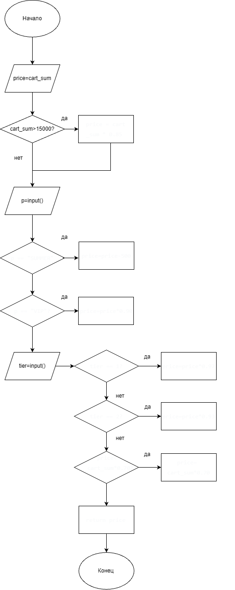

# Итоговый аналитический отчет (Лабораторная работа №1)

**Дисциплина:** Моделирование и анализ программного обеспечения
**Репозиторий:** (https://github.com/p4ela1409-ai/lab1-comprehensive-Pchelakiov)

## 1. Резюме (Executive Summary)

В рамках лабораторной работы спроектирован процесс разработки микросервиса
«Расчет корзины и скидок» системы лояльности. Выполнены: сравнительный анализ
СУБД (PostgreSQL vs MongoDB) с выбором PostgreSQL; настройка Git-инфраструктуры
(ветки main/develop/feature, CODEOWNERS, .editorconfig, branch protection);
настройка CI/CD на GitHub Actions с линтером flake8 и проверкой Quality Gate
методом «Сломать и починить»; обратное проектирование legacy-алгоритма расчёта
корзины в виде UML-диаграммы деятельности; подготовлен план code-review.

**Основные достижения:**
- Обоснован выбор PostgreSQL (ACID критичен для финансовых транзакций).
- Настроен автоматический контроль качества (flake8 в PR).
- Выявлены «запахи кода» в legacy-фрагменте и составлен план их устранения.

## 2. Сравнительный анализ технологий

### 2.1. Матрица принятия решений

| Критерий | Вес | PostgreSQL | MongoDB |
|---|---|---|---|
| Поддержка ACID-транзакций | 0.35 | 5 | 3 |
| Производительность чтения | 0.20 | 4 | 5 |
| Гибкость схемы | 0.15 | 3 | 5 |
| Стоимость владения | 0.15 | 4 | 3 |
| Экосистема и инструменты | 0.15 | 5 | 4 |
| **Сумма весов** | **1.00** | | |

### 2.2. Расчет и обоснование выбора

Формула взвешенной оценки:
Оценка = Σ (Вес_критерия × Балл_кандидата)

**PostgreSQL:**
0.35×5 + 0.20×4 + 0.15×3 + 0.15×4 + 0.15×5 =
1.75 + 0.80 + 0.45 + 0.60 + 0.75 = **4.35**

**MongoDB:**
0.35×3 + 0.20×5 + 0.15×5 + 0.15×3 + 0.15×4 =
1.05 + 1.00 + 0.75 + 0.45 + 0.60 = **3.85**

**Вывод:** выбран **PostgreSQL (4.35)**. Максимальный вес (0.35) отдан поддержке
ACID-транзакций, так как микросервис хранит историю финансовых транзакций и
баллов, где атомарность и консистентность критичны. Гибкость схемы MongoDB
менее важна для строго структурированных транзакционных данных.

## 3. Архитектура и контроль версий

### 3.1. Настройка репозитория

Модель ветвления (Git Flow-упрощённый):
- `main` — стабильная ветка (production-ready).
- `develop` — интеграционная ветка, защищена branch protection (требуется PR).
- `feature/*` — ветки под задачи: `feature/infrastructure`,
  `feature/qa-gates`, `feature/review-plan`.

Ссылка на репозиторий: (https://github.com/p4ela1409-ai/lab1-comprehensive-Pchelakiov)

### 3.2. Контроль доступа

**Branch protection для `develop`:**

<!-- 
 -->

**Содержимое `.github/CODEOWNERS`:**
@p4ela1409-ai

Все файлы требуют аппрува владельца кода перед слиянием.

## 4. Инструментальный контроль качества

### 4.1. Настройка CI/CD

Workflow: [`.github/workflows/qa.yml`](.github/workflows/qa.yml)

Запускается на `pull_request` в `develop`, устанавливает flake8 и выполняет
проверку с правилами из `.flake8` (max-line-length = 80).

### 4.2. Работа Quality Gate

**Скриншот перехода статуса red → green:**

<!-- 
-->

**Текст ошибки линтера (первый прогон):**
src/discount.py:1:1: F401 'os' imported but unused
src/discount.py:18:80: E501 line too long (118 > 79 characters)

**Описание исправления:**
- Удалён неиспользуемый `import os` (F401).
- Длинная строка с условием `if price < cart_sum * 0.70:` разбита:
  вычисление `min_price = cart_sum * 0.70` вынесено в отдельную переменную,
  условие приведено к короткому виду.
- Добавлена docstring, код приведён к стилю PEP 8.

После исправления статус проверки сменился на **зелёный (passed)**, PR смёржен
в `develop`.

## 5. Обратное проектирование и планирование ревью

### 5.1. Анализ алгоритма

**Встроенное изображение UML-диаграммы:**

[UML Diagram](docs/uml_diagram.png)

**Выявленные «запахи кода» (Code Smells) в legacy-фрагменте:**

1. **Магические числа** — `15000`, `0.85`, `500`, `0.90`, `0.97`, `0.93`, `0.70`
   не вынесены в именованные константы (нарушение читаемости и сопровождаемости).
2. **Отсутствие валидации входных данных** — нет проверки типов `cart_sum`,
   `tier`, `promos`; нет проверки неотрицательности суммы.
3. **Жёстко закодированные промокоды** — строковые литералы `"SUMMER"`, `"VIP"`
   вместо конфигурации/справочника.
4. **Отсутствие обработки неизвестных промокодов** — неизвестный промокод
   молча игнорируется, нет логирования/сигнала.
5. **Отсутствие docstring и типизации** — не указаны типы аргументов и
   возвращаемого значения.
6. **Дублирование бизнес-логики скидок** — логика базовой скидки и промокодов
   смешана в одной функции (нарушение Single Responsibility).
7. **Потенциальная проблема порядка операций** — скидка SUMMER (-500)
   применяется до процентных скидок, что может давать неинтуитивный результат;
   требуется явная фиксация бизнес-правила.
8. **Нет защиты от отрицательной цены** — при больших скидках и малом
   `cart_sum` возможна отрицательная цена (частично покрыто порогом 0.70, но
   требует явного теста).

### 5.2. План code-review

Подход: обязательный PR-ревью с аппрувом владельца кода (CODEOWNERS),
прохождение CI (flake8) до начала ревью, проверка по измеримым критериям
(отсутствие магических чисел, валидация входных данных, покрытие тестами > 80%,
граничные случаи). Эскалация: уровень 1 — обсуждение в PR; уровень 2 — Tech Lead;
уровень 3 — бизнес-аналитик; уровень 4 — руководитель разработки (блокирующие
проблемы безопасности/фрода).

Ссылка на открытый Pull Request с файлом `docs/review-plan.md`:
https://github.com/p4ela1409-ai/lab1-comprehensive-ВашаФамилия/pull/НОМЕР
<!-- 
 -->

## 6. Заключение

Настроенные процессы снижают риски внесения дефектов за счёт:
- **Branch protection + CODEOWNERS** — изменения в `develop` проходят только
  через PR с аппрувом владельца кода, что исключает случайные правки.
- **CI/CD (flake8)** — автоматический контроль стиля и явных ошибок на каждом
  PR; метод «сломать и починить» подтвердил работоспособность Quality Gate.
- **UML-диаграмма и выявленные code smells** — дают основу для рефакторинга
  legacy-алгоритма и написания тестов на граничные случаи.
- **План ревью с измеримыми критериями и эскалацией** — формализует проверку
  точности расчётов и защиты от фрода.

В совокупности эти меры обеспечивают прослеживаемость изменений, раннее
обнаружение дефектов и контролируемое качество кода микросервиса.

